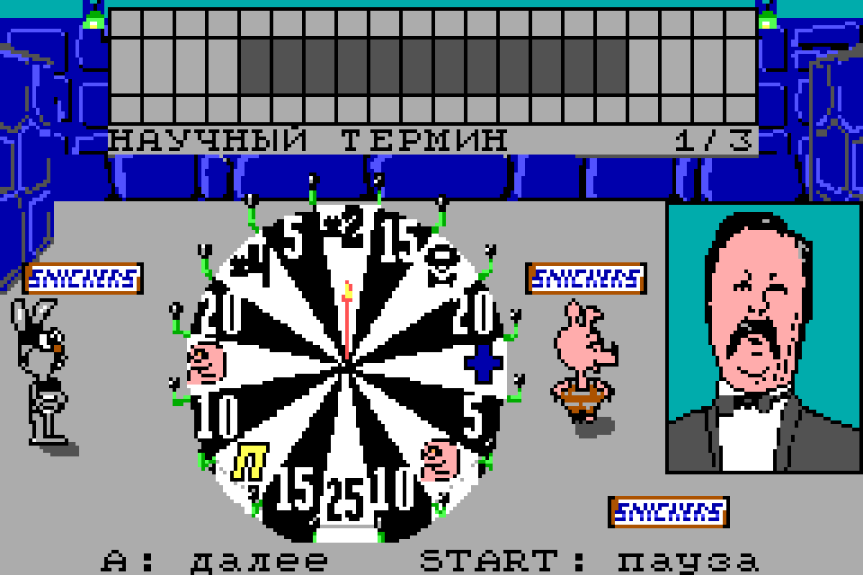

# «Поле чудес» для Game Boy Advance

Порт DOS-игры Димы Башурова на Game Boy Advance. Оригинальные персонажи, графика, база слов и звук PC Speaker; три раунда, призы и сохранение рекордов.

Версия **1.1**: исправлены цифры барабана, возвращён выбор «Скажу слово / Кручу барабан», открытые буквы закреплены при вводе ответа, восстановлен экран выдачи денег, аккуратно восстановлена надпись заставки с сохранением исходного начертания. ROM: `dist/pole 1.1.gba`. Сохранения рекордов совместимы с 1.0.

[История изменений](CHANGELOG.MD).

Статичные экраны рисуются по событиям. Таймеры анимации и автоповтора привязаны к VBlank; пустой звуковой буфер заполняется без синтеза отдельных сэмплов. [Замеры и проверка совместимости](docs/performance-audit.md).



## Как играть

Откройте ROM в эмуляторе GBA или загрузите на флеш-картридж.

| Кнопка | Действие |
|---|---|
| A | Подтвердить выбор меню, выбрать букву, продолжить; пропустить анимацию |
| Крестовина | Выбрать букву или вариант ответа |
| B | Удалить символ при вводе слова или имени |
| START | Пауза / продолжить; при вводе — подтвердить слово или имя |
| SELECT | Справка на заставке; пауза при вводе; на паузе — главное меню |
| L | В игре — звук; в меню — рекорды |
| R | В меню — просмотр графики; при вводе имени — пробел |

[Подробное управление](docs/play.txt).

## Сборка

Нужны Python 3, Zig 0.13.0 и PowerShell.

```powershell
.\scripts\build.ps1 -ZigExe C:\path\to\zig.exe -PythonExe C:\path\to\python.exe
```

Готовый ROM: `build/gba/pole.gba`.

[Документация для разработки](docs/development.md) · [Разбор DOS-версии](docs/reverse.md)

## Лицензия

Код порта распространяется по [лицензии MIT](LICENSE).
